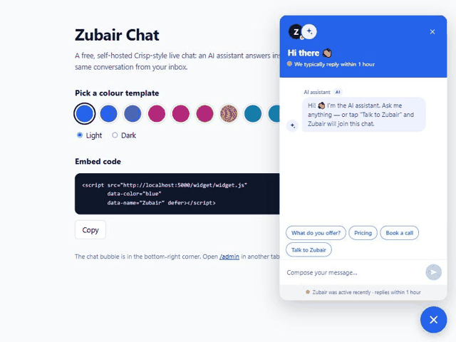
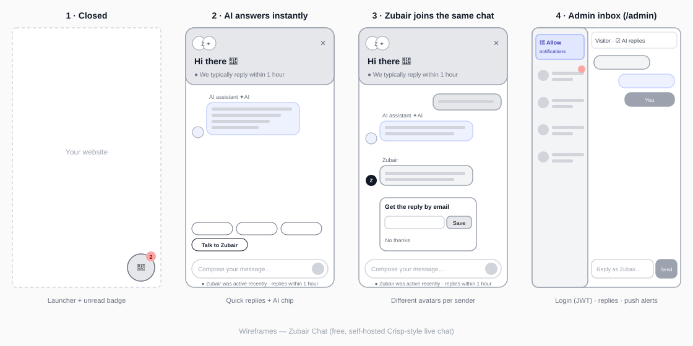

<div align="center">

# 💬 Zubair Chat

### A free, open-source, self-hosted alternative to Crisp

**Live chat + an AI assistant + a human inbox, all in one thread. One `<script>` tag. Deploys free on Vercel.**

[](MIT%20LICENSE)
[](https://nodejs.org)
[](https://vercel.com/new/clone?repository-url=https://github.com/Zubair-hussain/Zubair-Agent)
[](#-how-the-ai-works)



⭐ **If this saves you a chat subscription, star the repo — it's the only thing it costs.**

</div>

---

## Why

Hosted chat tools are great, but the features most small sites want — an AI that answers instantly, a human who can step in, and "we reply within 1 hour" — usually sit behind a monthly plan.

Zubair Chat gives you the same experience on infrastructure you own:

| | Zubair Chat | Typical hosted chat SaaS |
|---|---|---|
| Price | **Free** (MIT, runs on Vercel's free tier + Supabase free tier) | Free tier, then per-seat or per-feature plans |
| AI assistant | ✅ built in, no OpenAI/Gemini bill | Usually a paid add-on |
| Human takeover in the same thread | ✅ | ✅ |
| Online / "replies within 1 hour" status | ✅ | ✅ |
| Push notifications to your phone/desktop | ✅ Web Push | ✅ |
| Your data on your own database | ✅ | ❌ stored by the vendor |
| Branding badge you can't remove | ❌ none | Often on free plans |
| Source code you can change | ✅ | ❌ |

> Zubair Chat is an independent project and is not affiliated with or endorsed by Crisp.

---

## ✨ Features

- **One thread, three voices** — the visitor, the **AI assistant** (sparkle avatar + `AI` chip) and **you** (your initial or photo). Nobody is confused about who is talking.
- **Instant AI answers** from your own knowledge base — no external AI API, no quota, no bill.
- **Pick who to talk to** — tap the AI's avatar or yours in the header, just like a team of agents. The AI is selected by default.
- **"Talk to a human"** — ask the AI for you (or tap your photo) and the chat switches straight to you, with your greeting ("Hi there, I'm Zubair Hussain 👋") and when you were last active.
- **Presence** — "Online now" while your inbox is open, otherwise "We typically reply within 1 hour".
- **AI steps aside** for 10 minutes whenever you reply (or switch it off per conversation).
- **Email capture** — if you're away, visitors can leave an email so they don't miss your reply.
- **Admin inbox** at `/admin` — JWT login, unread badges, typing indicators, push notifications.
- **11 solid colour templates + dark mode**, or any hex colour.
- **Mobile-first** — full-screen on phones, keyboard-friendly, respects reduced motion.
- **Secure by default** — see [Security](#-security).

---

## ⚡ Add it to any website (30 seconds)

```html
<script src="https://YOUR-AGENT.vercel.app/widget/widget.js"
        data-color="blue"
        data-name="Zubair"
        defer></script>
```

Then add your site to `ALLOWED_ORIGINS` (see [Deploy](#-deploy-free-on-vercel)). Try every option live at **`/demo`** on your deployment.

| Attribute | Values | Default |
|---|---|---|
| `data-color` | `blue` `indigo` `violet` `pink` `crimson` `orange` `amber` `emerald` `teal` `slate` `black` — or a hex like `#0ea5e9` | `blue` |
| `data-mode` | `light` `dark` | `light` |
| `data-position` | `right` `left` | `right` |
| `data-name` | the human operator's name | `Zubair` |
| `data-fullname` | full name used in your greeting | same as `data-name` |
| `data-title` | header title | `Hi there 👋` |
| `data-avatar` | https URL of your photo | your initial |
| `data-quick` | quick replies separated by `\|` | `What do you offer?\|Pricing\|Book a call` |

Works with plain HTML, WordPress, Shopify, Webflow, Next.js, React, Vue… anything that can hold a `<script>` tag.

---

## 🎨 Colour templates

Solid primaries only — no gradients — so it matches almost any brand.


---

## 📐 Wireframes



1. **Closed** — round launcher with an unread badge.
2. **AI answers instantly** — quick replies and a clear `AI` label.
3. **You join the same chat** — your own avatar, plus the email capture card while you're away.
4. **Admin inbox** — conversation list, AI on/off switch, notification opt-in.

---

## 🚀 Deploy free on Vercel

```bash
git clone https://github.com/Zubair-hussain/Zubair-Agent.git
cd Zubair-Agent
npm install
npm run generate-secrets     # prints JWT_SECRET + VAPID keys
npm run hash-password        # hidden prompt → prints ADMIN_PASSWORD_HASH
```

1. Import the repo on Vercel.
2. **Database (free):** create a project at [supabase.com](https://supabase.com), open **SQL Editor → New query**, paste [`supabase/schema.sql`](supabase/schema.sql) and click **Run**. Then copy **Project URL** and the **service_role / secret key** from **Project Settings → API**. Required: serverless functions forget everything between requests. (Upstash Redis also works via `KV_REST_API_URL` / `KV_REST_API_TOKEN`.)
3. **Settings → Environment Variables**:

| Variable | Purpose |
|---|---|
| `SUPABASE_URL` / `SUPABASE_SERVICE_ROLE_KEY` | database (server-only key) |
| `ADMIN_USERNAME` | inbox login name |
| `ADMIN_PASSWORD_HASH` | salted scrypt hash — the password itself is never stored |
| `JWT_SECRET` | 32+ random characters; signs admin + visitor tokens |
| `VAPID_PUBLIC_KEY` / `VAPID_PRIVATE_KEY` / `VAPID_SUBJECT` | push notifications |
| `ALLOWED_ORIGINS` | your website origins, comma-separated, e.g. `https://example.com` |
| `REPLY_TIME_LABEL` | shown while you're away (default `within 1 hour`) |
| `EMAIL_USER` / `EMAIL_PASS` / `EMAIL_TO` | optional email alerts (Gmail app password) |
| `SERP_API_KEY` | optional live web search for tech questions |

4. Deploy, open `https://YOUR-AGENT.vercel.app/admin`, sign in and click **Allow** on the notification banner.

Changing the password: run `npm run hash-password` again and replace `ADMIN_PASSWORD_HASH` — every old session is logged out automatically.

Run locally: copy `.env.example` to `.env`, then `npm run dev` → `http://localhost:5000/demo`.

---

## 🧠 How the AI works

No LLM API. A weighted intent engine scores the message against ~20 intents (whole words, phrases weigh more, small typos tolerated, "yes" follows up on the previous answer) and replies from `src/knowledge/kb.js`.

**Make it yours:** edit `src/knowledge/kb.js` (who you are, services, prices, links, FAQ) and the response templates in `src/engine/responseBuilder.js`. That's it.

---

## 🔒 Security

- **Password:** scrypt with a per-password salt, constant-time comparison, identical error for wrong user or wrong password.
- **Brute force:** 5 failures per IP and 30 globally per 15 minutes, stored in Redis so it holds across serverless instances.
- **Session:** HS256 JWT (algorithm pinned, issuer + audience checked) in an `HttpOnly; Secure; SameSite=Strict; __Host-` cookie — page scripts cannot read it.
- **CSRF:** admin routes send no CORS headers and require a same-origin `Origin` + JSON body.
- **Visitors:** a JWT scoped to one conversation; it can't read other threads or reach admin routes.
- **XSS:** messages are stored as plain text and rendered with `textContent` only; strict CSP (`script-src 'self'`).
- **Abuse:** Redis-backed rate limits on every write, 16 KB body cap, origin allow-list enforced on the server.
- **SSRF:** push subscriptions are limited to real browser push services.
- **Email:** visitor input is HTML-escaped and single-line (no header injection).

`npm test` runs the end-to-end security suite (forged JWTs, CSRF, lockout, injection, oversized bodies).

Found a vulnerability? Please open a private security advisory on GitHub rather than a public issue.

---

## 📣 Help it go viral

This project grows only by word of mouth. If it helped you:

1. ⭐ **Star the repo** — stars are how other developers find it.
2. **Keep the tiny "Free chat by Zubair Chat" credit** in your site footer or README with a link back. Totally optional, hugely appreciated.
3. **Post your setup** — a 20-second screen recording of the AI answering and you jumping in performs well on X, LinkedIn and Reddit (`r/webdev`, `r/SideProject`, `r/selfhosted`). Tag it `#ZubairChat`.
4. **Write a "How I replaced my paid chat widget for $0" post** on dev.to / Hashnode / Medium and link the repo.
5. **Submit it** to lists like *awesome-selfhosted*, *Product Hunt*, *Hacker News (Show HN)* and *AlternativeTo*.
6. **Share a colour template or a translation** in [Discussions](https://github.com/Zubair-hussain/Zubair-Agent/discussions) — every new template gets credited in the README.
7. **Open a good first issue / PR** — new intents, languages, integrations (Slack/Telegram alerts), a WordPress plugin wrapper.

Ready-to-post blurb:

> I swapped my paid chat widget for **Zubair Chat** — free, open-source, AI answers instantly and I can jump into the same conversation from my phone. One script tag, deploys free on Vercel. https://github.com/Zubair-hussain/Zubair-Agent

---

## 🗂️ Project structure

```
src/
├── index.js               Express app (security headers, static admin + widget)
├── config.js              env-driven config — features fail closed without secrets
├── routes/index.js        all routes, CORS + rate limits
├── controllers/           live chat, admin inbox, public API
├── live/conversations.js  threads, messages, presence, typing
├── engine/                intent engine + response builder (the AI)
├── knowledge/kb.js        ← your profile, services, prices, FAQ
├── lib/                   auth (JWT/scrypt), store (Supabase/Upstash/memory), push, rate limit
├── admin/                 inbox UI + service worker for notifications
└── widget/                embeddable widget, colour templates, /demo page
supabase/schema.sql        free database setup (run once in Supabase)
docs/                      demo GIF, wireframes, colour templates
test/                      end-to-end security + flow tests
```

---

## 🔌 API Reference

### Chat — `POST /api/chat`

```bash
curl -X POST http://localhost:5000/api/chat \
  -H "Content-Type: application/json" \
  -d '{"message": "Hello"}'
```

**Try these messages:**
```
"Hello"                          → greeting + menu
"What can you build?"            → full skills overview
"Show me pricing"                → pricing table with timelines
"Tell me about Upwork"           → Upwork profile + badge
"Show me projects"               → portfolio + GitHub links
"Book a call"                    → Calendly + timezone windows
"How do I contact Zubair?"       → all contact links
"search React useEffect bug"     → live Google search
"I want to hire you"             → hire flow + all platforms
"Generate a contract"            → guided to contract endpoint
"Tell me about Xovato"           → agency overview
"What is Notion?"                → Notion portfolio link
```

**Response:**
```json
{
  "success": true,
  "intent": "greeting",
  "reply": "Hey there! 👋 Welcome to Zubair's AI assistant...",
  "timestamp": "2026-03-23T10:00:00.000Z"
}
```

---

### Generate Contract — `POST /api/contract`

```bash
curl -X POST http://localhost:5000/api/contract \
  -H "Content-Type: application/json" \
  -d '{
    "clientName": "John Smith",
    "clientEmail": "john@company.com",
    "projectTitle": "E-commerce Platform",
    "projectDescription": "Full MERN stack e-commerce with admin panel, payments, and inventory.",
    "budget": "$1500",
    "timeline": "3 weeks",
    "clientTimezone": "US/EST"
  }'
```

Sends a styled HTML proposal email to **both** Zubair and the client with full T&Cs.

---

### Contact — `POST /api/contact`

```bash
curl -X POST http://localhost:5000/api/contact \
  -H "Content-Type: application/json" \
  -d '{
    "senderName": "Sarah",
    "senderEmail": "sarah@startup.com",
    "subject": "Need a mobile app",
    "message": "Hi, I need a React Native app for my business...",
    "timezone": "AU/AEST"
  }'
```

Zubair's email is **never exposed** — all inquiries are forwarded securely.

---

### Search — `POST /api/search`

```bash
curl -X POST http://localhost:5000/api/search \
  -H "Content-Type: application/json" \
  -d '{"query": "React useState not updating fix"}'
```

---

### Profile Endpoints

```bash
GET /api/profile           # Full public profile
GET /api/profile/pricing   # Services & rates
GET /api/profile/timezone  # PKT time + all conversions
GET /api/live/status       # Is Zubair online + typical reply time
```

---


---

## 🤝 Connect

<div align="center">

[](https://www.linkedin.com/in/syed-zubair-hussain-shah-491294376)
[](https://github.com/Zubair-hussain)
[](https://www.upwork.com/freelancers/~01090ac35dc8078823?mp_source=share)
[](https://www.fiverr.com/s/NNGDEaQ)
[](https://wa.me/+923708729117)

</div>

---

<div align="center">

**If this helped you, drop a ⭐ — it means a lot from Pakistan 🇵🇰**

*Built by [Syed Zubair Hussain Shah](https://zubair-hussain-shah.vercel.app) — Xovato Digital Agency*


</div>
